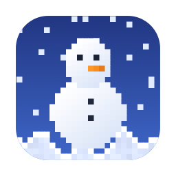
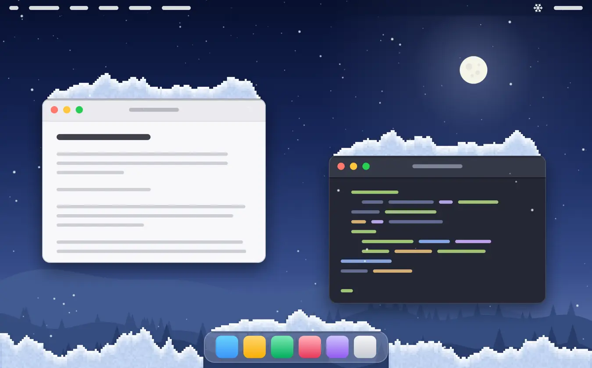
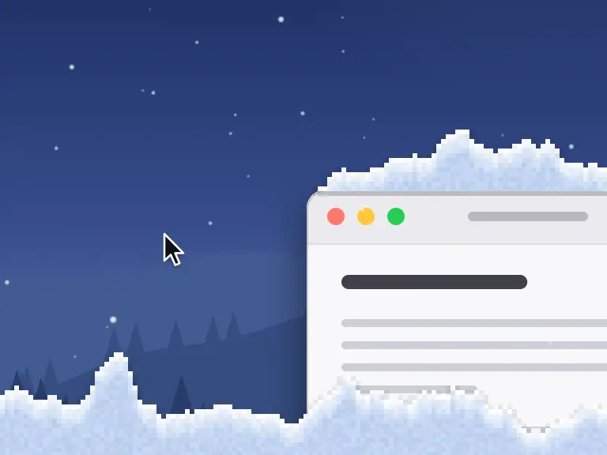
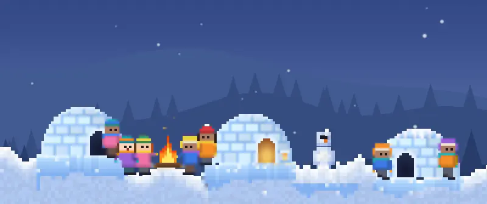

<div align="center">



# Sugrob

**Physically simulated snow for your Mac desktop**

English · [Русский](README.ru.md)

[](https://github.com/niazlv/sugrob/releases/latest)

[](LICENSE)
[](https://github.com/niazlv/sugrob/actions/workflows/build.yml)



**[Download Sugrob.dmg](https://github.com/niazlv/sugrob/releases/latest/download/Sugrob.dmg)**

</div>

Sugrob (Russian for “snowdrift”) lives in the menu bar. Snow falls over your desktop, settles on
windows, the Dock and the bottom of the screen, and from then on behaves like snow: you can brush
it away, push it off an edge or roll it into a ball. Clicks pass straight through, so it never
gets in the way of work.

<table>
<tr>
<td width="50%"><br><b>Snowman.</b> A ball grows as it rolls. Stack three of them.</td>
<td width="50%"><br><b>Visitors.</b> They build a ladder out of snow and climb onto your window.</td>
</tr>
<tr>
<td><br><b>Christmas tree.</b> Sooner or later someone drags one in.</td>
<td><br><b>Snow squall.</b> It arrives uninvited, strips the caps off windows and sends snow drifting.</td>
</tr>
</table>

## What it does

- **Snow that acts like snow.** Settled snow is a grid of small cubes. Anything knocked loose flies
  off in chunks, slides down slopes and settles again; volume is conserved. Over time snow packs
  down, slumps and freezes into a blue icy crust.
- **You can touch it.** Brush it away with the cursor, push it off a window edge, roll a ball,
  throw a snowball, build a snowman.
- **It sticks to your windows.** Drag a window and its drift rides along; close it and the snow
  falls. Each desktop (Space) and each full-screen app keeps its own snow, which slides away and
  comes back with it when you swipe between them.
- **It stays off your video.** While a window is playing video, no snow is drawn over it, as if
  it were falling behind the window.
- **Little people.** Every so often a group in parkas and bobble hats wanders in. They have
  snowball fights, build snowmen, dig tunnels and pull each other on sledges. If one of them gets
  buried, the others run to dig them out. Some stay for good and build an igloo.
- **Weather.** Light snow, steady snowfall or a blizzard, wind in either direction, and a squall
  that turns up whenever it likes.
- **It doesn't peek.** No screen recording, no accessibility access. The app reads window frames
  only, never titles or contents. It knows where video is playing indirectly: from which app has
  asked the system to keep the display awake.
- **Snow on desktop icons, if you ask for it.** Folders, apps and files on the desktop can wear
  caps too, but only Finder knows where they are, and it shares that through Accessibility. So
  the option is off until you turn it on yourself (Snowdrifts → Where Snow Settles), and only then
  does macOS ask for permission, in the name of “Sugrob Desktop Icons”: a small helper inside the
  app that does the talking to Finder. It takes each icon's frame and kind; names are not kept and
  files are not opened. Pictures, videos and PDFs also need their proportions, which come from
  Spotlight, and for that macOS separately asks for access to the Desktop folder. Decline, and
  snow settles on everything except thumbnails.

Everything can be adjusted or switched off from the ❄ menu.

## Install

1. Download [Sugrob.dmg](https://github.com/niazlv/sugrob/releases/latest/download/Sugrob.dmg),
   open it and drag Sugrob onto the Applications folder. (The same app as a plain archive is
   [Sugrob.zip](https://github.com/niazlv/sugrob/releases/latest/download/Sugrob.zip).)
2. The app is not notarized by Apple, so the first launch needs your approval: try to open it,
   then go to **System Settings → Privacy & Security** and click **Open Anyway**. Or remove the
   quarantine flag in Terminal:

   ```bash
   xattr -dr com.apple.quarantine /Applications/Sugrob.app
   ```

3. There is no window. Look for the ❄ icon in the menu bar.

Requires macOS 13 or later. The build is universal (Apple Silicon and Intel), but it has been used
day to day only on Apple Silicon with macOS 26.

Sugrob updates itself: every few hours it checks this repository's releases and installs a new
version while the Mac is idle. The update manifest is signed, and automatic updates can be turned
off in the menu.

## Controls

| To do this | Do this |
| --- | --- |
| Brush snow away | Move the cursor through a drift |
| Scatter snow | Flick the cursor through it |
| Make a snowball | Hold `⌃⌥`, press the mouse button on snow and drag |
| Throw a snowball | Release while moving |
| Build a snowman | Lower a ball gently onto the top of another |
| Pick a ball up again | Hold `⌃⌥` and press on it |
| Crack the icy crust | Strike it sharply with the cursor, or throw a snowball |
| Tease the little people | Clip one with a fast cursor or a ball, and expect a snowball back |

The app speaks your system language: English, Russian, German, Spanish, French, Portuguese,
Simplified Chinese and Japanese; any other language falls back to English. The translations
(everything except the Russian original) were made by AI and have not been checked by native
speakers, so corrections are welcome: the strings live in `Resources/<language>.lproj/Localizable.strings`.

## Resource use

Sugrob is light on the processor and memory. What it does cost is a little GPU time: the
transparent layer over your desktop is redrawn 60 times a second, and the Mac's window compositor
has to blend it each time. Measured on version 1.4, MacBook Pro with an M1 Max, a 3456×2234
display and macOS 26, plugged in, with the app in its usual state:

| | |
| --- | --- |
| CPU | about 2 % of the chip, almost all of it on efficiency cores: 0.1 W |
| Memory | 100–110 MB |
| GPU | 2–3 % of the GPU's time for the snow itself |
| System processes | about +1.5 % of the chip in `WindowServer` and `launchservicesd` |
| **Whole Mac, extra power** | **about 1 W** (0.9–1.4 W), mostly GPU and compositor |

Activity Monitor counts one core as 100 %, so it shows Sugrob at about 20 %. The M1 Max has ten
cores, which makes that 2 % of the chip.

That is not nothing: on a laptop battery it is roughly 1–2 % of the charge per hour, or 5–15 %
off the runtime, depending on what else the Mac is doing. It is small next to what warms a Mac
or spins up a fan, which is tens of watts.

<details>
<summary><b>How this was measured</b></summary>

- CPU and memory: `top`, `footprint` and `proc_pid_rusage` (the per-process energy counter).
- GPU time: the per-process counters of the `IOAccelerator` service.
- Energy: the chip's own CPU, GPU and DRAM energy counters (IOReport, no root needed), with the
  app alternately running and frozen with `SIGSTOP` in 15-second windows, six pairs. The GPU
  difference was steady (+0.8 W median). CPU readings for the whole chip were swamped by other
  apps, so the CPU and system-process shares are estimated from the load they add.
- The whole-Mac figure is an order of magnitude, not a precise number. Not measured: blizzards,
  a crowd of little people, several displays, an Intel Mac.

</details>

## Build from source

You need Xcode or its command-line tools (Swift 5.9 or later). There are no dependencies.

```bash
./build.sh
```

The app is written to `build/Sugrob.app`. The simulation does not depend on the UI and is tested
headless; GitHub Actions runs the same stress test on every push:

```bash
.build/release/Sugrob --fuzz 300 1 3
```

<details>
<summary><b>How it works</b></summary>

- **Two states of snow.** Settled snow lives in a grid: one byte per cell, plus a “hardness” byte
  for ageing. Loose snow is a list of particles with velocity, gravity and wind. A cell that loses
  its support becomes a particle; a particle that lands on something becomes a cell.
- **Ledges.** The top edges of visible windows and widgets, the Dock and the bottom of the
  screen. Window frames come from `CGWindowListCopyWindowInfo`, which needs no permission as long
  as titles are not read. System windows (widgets, the Dock) are recognised by the owning process's
  bundle id rather than its name, because macOS reports the name translated.
- **Desktop icons** (when enabled). Through the Accessibility API Finder reports each icon's frame
  and URL; only the extension and whether it is a folder are taken from the URL. The icon's “roof”
  is measured on the system icon for that type (`NSWorkspace.icon(for:)`): the widest level stretch
  of its top edge. Finder fits a thumbnail into a square 7/8 the icon size, and its proportions
  come from Spotlight metadata (`kMDItemPixelWidth/Height`).
- **The helper and permissions.** macOS ties Accessibility access to a program's signature, and
  Sugrob has no developer certificate: its signature is a hash of the binary and changes with every
  build. So that access does not have to be granted again after every update, Finder is queried
  not by Sugrob but by a helper, `Contents/Helpers/SugrobIcons.app` (source in
  `Sources/SugrobIcons`). It runs as a program of its own and never changes by a single byte: every
  build ships the same prebuilt file from `Resources/SugrobIcons.app`. All it can do is report the
  frames and kinds of desktop icons; everything else lives in Sugrob itself. It can be rebuilt with
  `tools/icons-helper/freeze.sh`, but that resets the permission for everyone.
- **Video.** A player asks the system to keep the display awake while it plays; the list of such
  requests (`IOPMCopyAssertionsByProcess`) is available without any permission. The visible part of
  that app's windows is blanked at the end of each frame. The cap on the window itself and snow on
  windows in front of it stay.
- **Rendering.** One transparent, click-through Metal layer per desktop and per full-screen
  space. The grid is uploaded as a texture and shaded in a fragment shader.
- **Input.** The cursor position and modifier keys are polled, so no events have to be intercepted.
  The layer captures the mouse only while `⌃⌥` is held.
- **The little people** are part of the same simulation, not a cartoon drawn over it. A snowball
  is made of cells taken from a drift, ladder steps are trampled snow, and an avalanche really
  does bury whoever is underneath.

The identifier of the current desktop and the Dock's rectangle come from undocumented macOS calls
that are looked up at launch. If they are missing, the app falls back to one shared layer and an
estimated Dock size.

The animations on this page are recorded by `tools/readme-media/make.sh`, using the same
simulation with no screen attached.

</details>

## Support

<div align="center">



<sub>The campfire runs on donations.</sub>

</div>

Sugrob is free, with no ads and no subscriptions. There is exactly one subscription involved: the
author's Claude plan, and that is where donations go. If you know, you know. If you don't, think
of it as buying the author a coffee, except that a neural network drinks it.

<div align="center">

&nbsp;
&nbsp;
&nbsp;
&nbsp;


<sub>Click a card to open it on its own at full size, which makes it easier to scan.</sub>

</div>

| Network | Address |
| --- | --- |
| Bitcoin | `bc1qyt9hzvtd69t5jkk7h39fqd4pz7tg9jl9pq4arf` |
| Ethereum (ERC-20)<br><sub>also Base, Arbitrum, Optimism, Polygon, Linea</sub> | `0xBA10A984A88AeE82A2D3b30EA6d91BC554D46A25` |
| BNB Chain (BEP-20) | `0xBA10A984A88AeE82A2D3b30EA6d91BC554D46A25` |
| Solana | `9GhoGBorb8xvkUjFgGfrcFun1m6ad9K9chDUhvagXYwX` |
| Tron (TRC-20) | `TKyahQhTeLdMraKDbedLz17jorRTfER8xX` |

In your wallet, pick the same network as in the row with the address: a transfer sent on any other
network will not arrive.

## License

[MIT](LICENSE)
