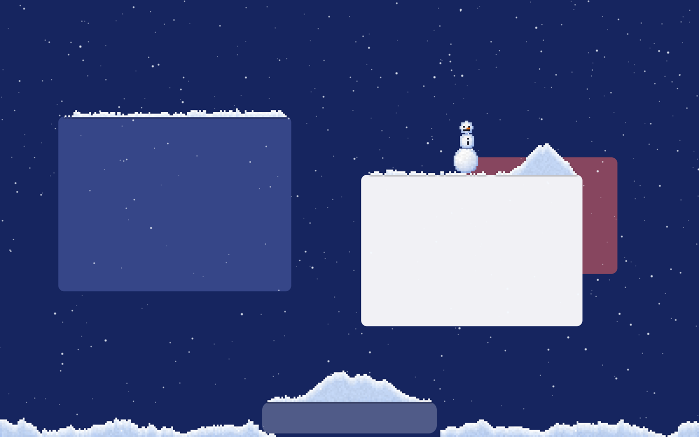
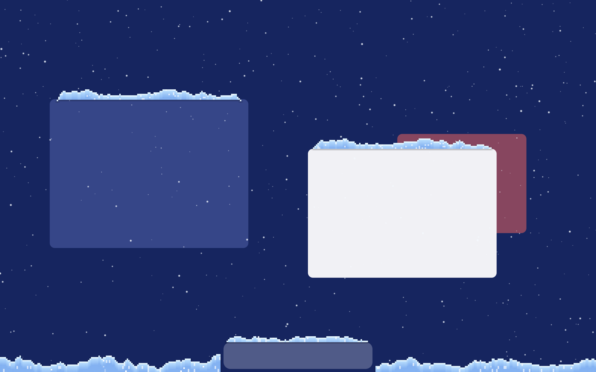

# Сугроб

**Снег с настоящей физикой на рабочем столе Mac.**

[English](README.md) · Русский




Сугроб — небольшое приложение в строке меню. Снег идёт поверх рабочего стола, ложится на верхние
края окон, на Dock, на виджеты и вдоль низа экрана — и дальше ведёт себя как снег. Его можно
смахнуть курсором, столкнуть с края окна, скатать в шар, бросить снежком и слепить снеговика.
Клики проходят сквозь снег, так что работать он не мешает.

| Снег сталкивают с окна | Старый снег подмерзает в наст |
| --- | --- |
|  |  |

## Что умеет

- **Воксельный снег.** Лежащий снег — сетка маленьких кубиков; всё, что сбили, превращается
  в летящие комья, которые падают, скатываются по склону и снова ложатся. Объём сохраняется.
- **Смахивать и сгребать.** Ведите курсор сквозь сугроб: медленно — он гонит перед собой вал,
  резким взмахом — снег разлетается.
- **Снежки.** Зажмите `⌃⌥` и тяните — слепится шар. Он катится по поверхности и наматывает
  верхний слой, поэтому растёт на ходу. Отпустите на ходу — полетит; от сильного удара рассыплется.
- **Снеговики.** Мягко опустите шар на другой — прилипнет. У верхнего появятся глаза, морковка
  и улыбка.
- **У шаров есть вес и возраст.** С горки они катятся сами. Тяжёлый шар проваливается в рыхлый
  снег, уплотняет его и гонит перед собой вал. Шар, который давно стоит, примерзает, его заметает,
  он оседает и в конце концов становится сугробом.
- **Снег стареет.** Свежий — рыхлый. Через несколько минут он слёживается, позже подмерзает
  в голубой наст, по которому курсор просто скользит; наст колется резким ударом или снежком.
- **Снег держится за окна.** Перетащите окно — сугроб поедет с ним; закройте — снег осыплется.
  Линия снега повторяет закруглённые углы окон. У каждого рабочего стола свой снег.
- **Погода.** Лёгкий снег, снегопад или метель; ветер в любую сторону; высота сугробов; размер
  вокселя.
- **Без разрешений.** Ни записи экрана, ни универсального доступа. Приложение читает только
  рамки окон — не заголовки и не содержимое.

Всё включается и выключается в меню ❄.

## Установка

1. Скачайте `Sugrob.zip` из [последнего релиза](https://github.com/niazlv/sugrob/releases/latest).
2. Распакуйте и перенесите `Sugrob.app` в «Программы».
3. Приложение не заверено Apple, поэтому первый запуск нужно разрешить вручную: попробуйте
   открыть его, затем зайдите в **Системные настройки → Конфиденциальность и безопасность**
   и нажмите **Всё равно открыть**. Либо снимите карантин в Терминале:

   ```bash
   xattr -dr com.apple.quarantine /Applications/Sugrob.app
   ```

Нужна macOS 13 или новее. Сборка универсальная (Apple Silicon и Intel); в повседневной работе
она проверена только на Apple Silicon с macOS 26.

Окна у приложения нет: ищите значок ❄ в строке меню.

## Управление

| Действие | Как |
| --- | --- |
| Смахнуть снег | Провести по нему курсором |
| Бросить снег | Резко взмахнуть курсором сквозь сугроб |
| Слепить снежок | Зажать `⌃⌥`, нажать кнопку мыши на снегу и тянуть |
| Бросить снежок | Отпустить на ходу |
| Слепить снеговика | Мягко опустить шар на макушку другого |
| Снова взять шар | Зажать `⌃⌥` и нажать на него |
| Покатать свободный шар | Просто толкать его курсором |
| Расколоть наст | Резкий удар курсором или снежок |

## Сборка из исходников

Нужен Xcode (или его инструменты командной строки) со Swift 5.9 или новее. Зависимостей нет.

```bash
./build.sh          # build/Sugrob.app под этот Mac
./build.sh --dist   # универсальная build/dist/Sugrob.app и build/Sugrob.zip
```

Симуляция не зависит от интерфейса и проверяется без экрана:

```bash
.build/release/Sugrob --fuzz 300 1 3      # 300 секунд случайных действий, seed 1, воксель 3 pt
.build/release/Sugrob --selftest shots    # сценарий с отрисовкой кадров в PNG в папку ./shots
```

Стресс-тест падает, если какой-то шаг симуляции длится слишком долго — так зависание ловится до
того, как попадёт на настоящий рабочий стол. Каждая отправка в репозиторий собирается
и проходит этот тест в GitHub Actions.

## Как это устроено

- **Два состояния снега.** Лежащий снег хранится в сетке (байт на воксель плюс байт «слежалости»).
  Летящий — список частиц со скоростью, гравитацией и ветром. Воксель, потерявший опору,
  становится частицей; частица, упавшая на опору, становится вокселем и скатывается, пока склон
  не станет пологим.
- **Опоры.** Это верхние края видимых окон, Dock и низ экрана. Рамки окон берутся из
  `CGWindowListCopyWindowInfo`; пока не читаются заголовки, особых разрешений для этого не нужно.
- **Отрисовка.** Прозрачный, пропускающий клики слой Metal на каждый рабочий стол. Сетка
  загружается текстурой и раскрашивается во фрагментном шейдере, частицы рисуются точками.
- **Ввод.** Положение курсора и клавиши-модификаторы опрашиваются, поэтому слою не нужно
  перехватывать события. Мышь он ловит только пока зажаты `⌃⌥`.

Две вещи опираются на недокументированные вызовы macOS, которые ищутся при запуске: номер
текущего рабочего стола (чтобы у каждого был свой снег) и рамка Dock. Если их нет, приложение
обходится одним общим слоем и оценкой размера Dock.

## Обновления

Приложение раз в несколько часов проверяет релизы этого репозитория. Манифесты обновлений
подписаны, а ставится обновление только когда за Mac минуту никто не работал. Автоматические
обновления выключаются в меню **Обновления**.

## Поддержать

Если с Сугробом на рабочем столе стало уютнее, проект можно поддержать. Пожалуйста, отправляйте
только в той сети, которая указана рядом с адресом.

| Сеть | Адрес |
| --- | --- |
| Bitcoin (Native SegWit) | `bc1qyt9hzvtd69t5jkk7h39fqd4pz7tg9jl9pq4arf` |
| Ethereum | `0xBA10A984A88AeE82A2D3b30EA6d91BC554D46A25` |
| BNB Chain (BEP-20) | `0xBA10A984A88AeE82A2D3b30EA6d91BC554D46A25` |
| Base | `0xBA10A984A88AeE82A2D3b30EA6d91BC554D46A25` |
| Polygon | `0xBA10A984A88AeE82A2D3b30EA6d91BC554D46A25` |
| Solana | `9GhoGBorb8xvkUjFgGfrcFun1m6ad9K9chDUhvagXYwX` |
| Tron (TRC-20) | `TKyahQhTeLdMraKDbedLz17jorRTfER8xX` |

Адрес Ethereum тот же в сетях Arbitrum, Optimism и Linea.

## Лицензия

[MIT](LICENSE)
